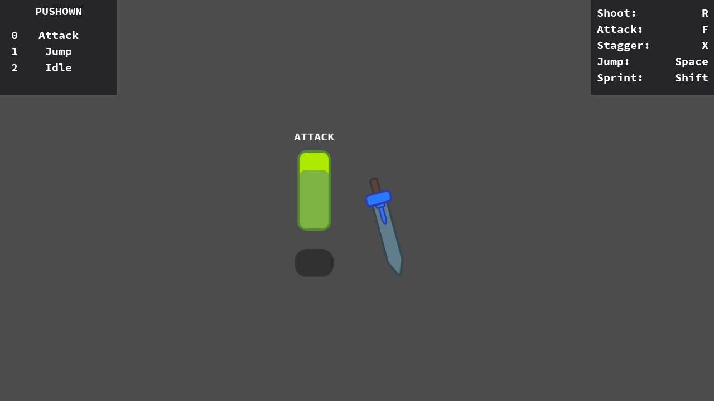
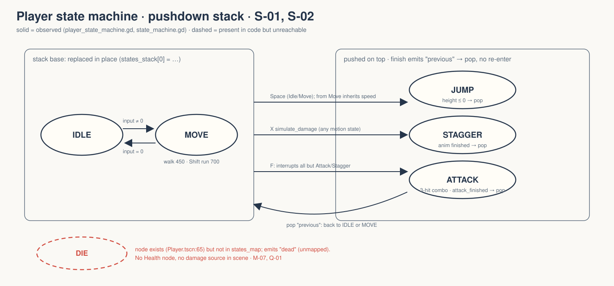

# walker-2d-finite-state-machine: Game Design Document (recovered)

| | |
|---|---|
| Version | 0.1.0-recovered |
| Date | 2026-09-27 |
| Author | Zelda (agent, silent), for Nik Bear Brown |
| Mode | recovered · `/gdd reverse --path godot silent` |
| Revision | 1 |
| Gates | vision ○ · systems ○ · world ○ · scope ○. Gate unsigned at time of writing |
| Classification | **Tech demo, not a game.** A top-down character on an empty floor, built to show a hierarchical state machine with a pushdown stack. No enemies, goal or end. |

Provenance tags: `[OBSERVED path:line]` · `[INFERRED]` with evidence · `[MISSING]`. Paths are relative to `godot/` unless they start with the folder root. A recovered GDD describes what exists. It approves none of it.

*`godot/screenshots/fsm-attack.png` (1280×720), shipped upstream and referenced by `godot/README.md:32`. This is design art, not a Walker capture. The root `README.md` says no rendered frames have been verified.*

## 1. Vision summary

**What it is.** "This example shows how to apply the State machine programming pattern in GDscript, including Hierarchical States, and a pushdown automaton" `[OBSERVED godot/README.md:3-5]`. The same explanation is shown on screen (`Demo.tscn:62`).

**Player fantasy / target player.** `[MISSING]` `[INFERRED]` The audience is programmers learning the State pattern. The evidence: the README cites Game Programming Patterns (`godot/README.md:27-28`), and debug panels show the live state stack (`debug/states_stack_displayer.gd`).

**Biggest unresolved question.** The code carries unfinished combat hooks (damage, health, death) that nothing in the scene can trigger. Finish them into a small action game, or treat them as out of scope? Q-01.

## 2. Design pillars

`[MISSING]` No player pillars. `[INFERRED]` The upstream README lists three *engineering* goals: separate behaviours and transitions, single responsibility per state, and a structure readable from the scene tree (`godot/README.md:15-25`). These are code-architecture principles, not player-experience pillars.

## 3. Core loop

**Micro.** Press an input and watch the state label and the stack panel change: Idle ↔ Move, push Jump, Stagger or Attack, then pop back to the previous state `[OBSERVED player/player_state_machine.gd:21-43; state_machine/state_machine.gd:70-84]`.
**Meso / macro.** `[MISSING]` No objective, level or session structure.
**Loop honesty test.** Controls with no stakes. This is an inspection loop for a code pattern, not a game loop.

## 4. Player Experience Goals

`[MISSING]` None authored. Candidate, `[INFERRED]`: PX-01, "the viewer can see why a pushdown stack returns Jump to Move rather than to Idle". The evidence is the stack displayer and `previous` popping (`state_machine.gd:75-76`). Not approved.

## 5. Mechanics

### M-01 Ground movement: Idle / Move `[OBSERVED player/states/motion/on_ground/idle.gd; move.gd]`
Eight-way input from four actions (`motion.gd:9-13`). Move speed is 450 walking and 700 while `run` (Shift) is held (exported, `move.gd:3-4,25-28`). A zero input returns to Idle.

### M-02 Jump, a pushed state `[OBSERVED player/states/motion/in_air/jump.gd]`
Space pushes Jump. When entered from Move, Jump inherits Move's speed and velocity (`player_state_machine.gd:27-28`). The "height" is simulated: vertical speed 600, gravity 1600, and `BodyPivot.position.y = -height` (lines 37, 9, 67-72). Air control uses exported acceleration 1000, deceleration 2000, steering 50 and base max 400. At height 0 it pops `previous`.

### M-03 Stagger, a pushed state `[OBSERVED player/states/combat/stagger.gd; motion.gd:4-6]`
X (`simulate_damage`) pushes Stagger from any motion state. It plays the "stagger" animation and pops on `animation_finished`.

### M-04 Sword attack and combo `[OBSERVED player/player_state_machine.gd:36-41; player/weapon/sword.gd]`
F pushes Attack unless the player is already attacking or staggered. The Sword runs a three-hit combo: damage 1 / 1 / 3, animations attack_fast ×2 then attack_medium (`sword.gd:19-38`). AnimationPlayer method tracks open an input buffer (`set_attack_input_listening`, `set_ready_for_next_attack`, `Sword.tscn:149-163`). A buffered F chains the next swing. `attack_finished` pops the Attack state. Verified by 11 combo checks (`combo-20260927.log`).

### M-05 Shoot `[OBSERVED player/bullet/bullet_spawner.gd; bullet.gd]`
R (`fire`) spawns a bullet in the look direction, with a 0.2 s cooldown (`Player.tscn:86-87`). The bullet speed is 1000. The bullet frees itself off-screen or on collision.

### M-06 Look direction and weapon pivot `[OBSERVED player/player_controller.gd:8-29; player/weapon/weapon_pivot.gd]`
`look_direction` emits `direction_changed`. The weapon pivot rotates to face it and drops behind the body when facing up.

### M-07 Damage, health and death: **present in code, unreachable in scene** `[OBSERVED]`
- `player_controller.gd:14-19` calls `$Health.take_damage`, but `Player.tscn` has **no Health node** `[OBSERVED Player.tscn:44-113 node list]`.
- `sword.gd:100-107` damages only bodies with a `Health` child. `Demo.tscn` contains no such body `[OBSERVED Demo.tscn node list; FRICTIONAL.md:26-29]`.
- A `Die` state node exists (`Player.tscn:65-66`) but is **not in `states_map`** (`player_state_machine.gd:12-18`), and it emits `dead`, which has no mapping.
`[INFERRED]` These are scaffolding carried over from upstream, not working features. The test logs never exercise them.

Tuning values are `[OBSERVED]` numbers, not approved design.

## 6. Systems

| ID | System | Owner | Evidence |
|---|---|---|---|
| S-01 | Generic state machine (stack, `previous`) | `state_machine/state_machine.gd` | `[OBSERVED]` |
| S-02 | Player state machine (push rules, attack interrupt) | `player/player_state_machine.gd` | `[OBSERVED]` |
| S-03 | Sword combo sub-machine (IDLE/ATTACK × input IDLE/LISTENING/REGISTERED) | `player/weapon/sword.gd:5-17` | `[OBSERVED]` |
| S-04 | Debug UI (stack panel, state label, controls, explanation) | `debug/*`, `state_name_displayer.gd` | `[OBSERVED]` |

No save/load, audio or scene transitions `[OBSERVED absence]`.

## 7. Progression

`[MISSING]` None.

## 8. World

`[OBSERVED]` A single 1280×720 screen (`project.godot:28-29`). The player starts at (640,400) (`Demo.tscn:36-37`). There are no colliders or environment nodes, although `move.gd:33` checks for an "environment" group `[OBSERVED FRICTIONAL.md:26]`. `[MISSING]` Setting.

## 9. Narrative

`[MISSING]` None. The on-screen text is a programming explanation, not story (`Demo.tscn:62`).

## 10. Characters

`[OBSERVED]` One unnamed player: a body sprite, a shadow and a sword (`player/body.png`, `shadow.png`, `weapon/sword.png`). `[MISSING]` Name or role.

## 11. Features and priority

| ID | Feature | State | Evidence |
|---|---|---|---|
| F-01 | Idle/Move/Run | headless-verified | `input-debug-20260927.log` |
| F-02 | Jump push/pop + body height | headless-verified | same |
| F-03 | Stagger push/pop | headless-verified | same |
| F-04 | Attack + 3-hit combo | headless-verified (14 + 11 checks) | `input-*.log`, `combo-20260927.log` |
| F-05 | Bullet spawn | headless-verified | "R spawns bullet" |
| F-06 | Debug stack + label | headless-verified | 18/18 |
| F-07 | Hit/damage/death (M-07) | **not reachable**: no target, no Health, Die unmapped | `FRICTIONAL.md:26-29` |
| F-08 | Font license packaging | **pending** | `FONT-PROVENANCE.md:12-15` |

CORE percentage: not computed `[MISSING MVP]`.

## 12. Out of scope

`[OBSERVED absence]` Enemies, level geometry, win/lose conditions, audio.

## 13. Technical

Godot 4.7, Compatibility renderer. Physics at 120 ticks/s with interpolation (`project.godot:19,98-106`). Main scene `res://Demo.tscn`. Input actions (`project.godot:33-96`): `move_*` (arrows, WASD, stick, D-pad), `run` (Shift, joypad 1), `jump` (Space, joypad 0), `attack` (F, joypad 2), `fire` (R, joypad 7), `simulate_damage` (X, joypad 3). The state machine uses `_unhandled_input` and `_physics_process` delegation (`state_machine.gd:55-60`). Font: Source Code Pro Bold 2.030, SIL OFL 1.1 (`FONT-PROVENANCE.md`). Tests: `test_input.gd` (18) and `test_combo.gd` (11).

## 14. Risks

| ID | Risk | Evidence |
|---|---|---|
| R-01 | Calling `take_damage` would error: no `Health` node | `player_controller.gd:19`, `Player.tscn` |
| R-02 | A film implying working combat or death | `FRICTIONAL.md:26-29` |
| R-03 | Redistribution without a font license file | `FONT-PROVENANCE.md:12-15` |
| R-04 | The run-into-environment branch is dead code (no environment nodes) | `move.gd:33-34` |

## 15. Open questions

See `design/decisions.md`: Q-01 through Q-06.

## 16. Tests

Existing: `test_input.gd`, 18 checks (`input-debug-20260927.log`). `test_combo.gd`, 11 checks (`combo-20260927.log`). All use keyboard events through `Input.parse_input_event`.
Proposed (dashed): T-01 an explicitly labelled fixture target with a Health node, to exercise sword damage. T-02 a rendered capture of the stack panel during Move → Jump → land. H-01 a programmer watches for one minute and explains why Jump returns to Move.

## Zelda's notes (silent mode; what I would have said out loud)

- **Ghost Center, as expected.** This is a code-pattern demo wearing a sword. The player has nothing to do with the sword.
- **Mechanic Mirage, textbook case.** Damage values, a Health lookup, a Die state and knockback are all in the source. None of them can fire in this scene. Anyone skimming the code will think there's combat. There isn't. That's why M-07 is written out in full.
- **The pushdown stack is the one idea worth filming.** Move → Jump → land back in Move, with the stack panel visible. That shot teaches the pattern. The rest is controls.
